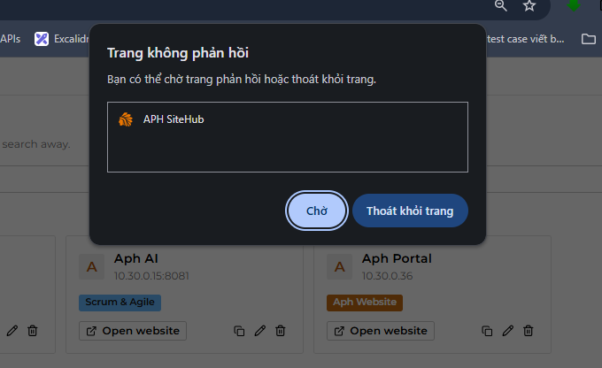
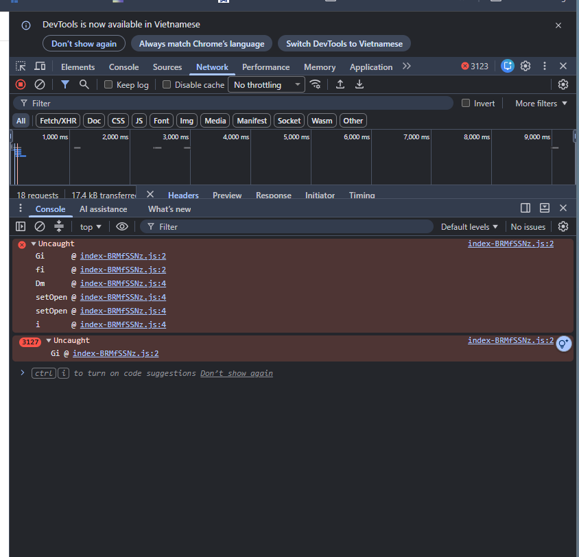
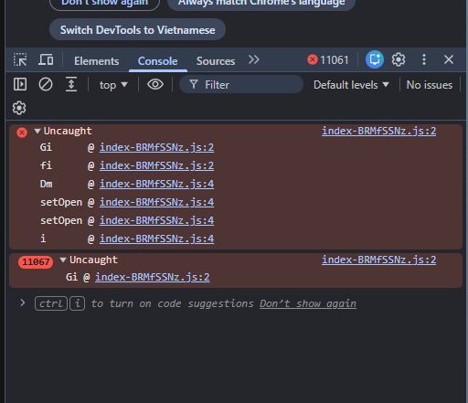
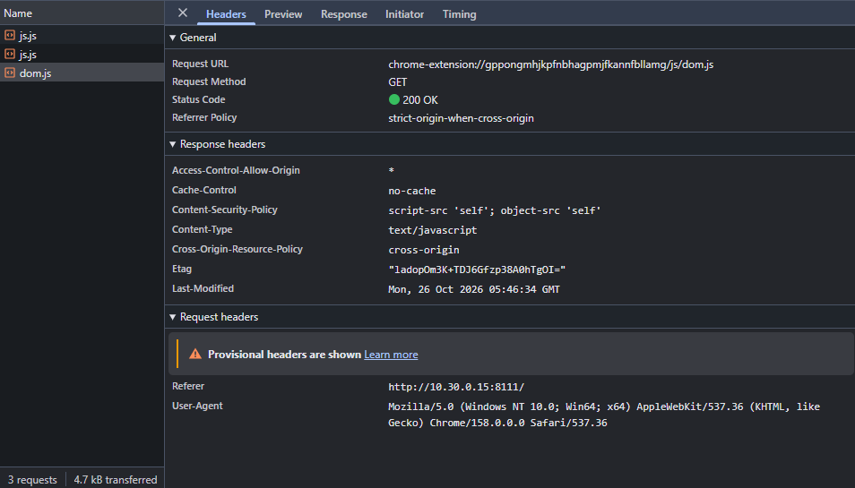

# [Bug] Chrome tab becomes unresponsive; `Uncaught` error repeats >10,000 times (`flushPending` of `@tanstack/redact` exceeds 50 iterations)

## Summary

While using the SiteHub UI in Chrome on Windows, the tab sometimes freezes and Chrome shows
"Page Unresponsive". The console fills with tens of thousands of `Uncaught` errors that have no
message. The error is thrown by the render-queue loop of `@tanstack/redact`, but the **root cause
is not yet identified**.

## Repository and how to test

- Repository: <https://github.com/phinhannguyen04/aph-siteHub>
- Commit that produces the affected bundle (`index-BRMfSSNz.js`):
  <https://github.com/phinhannguyen04/aph-siteHub/tree/b88732806bc8dc34994f5b126aead956b5d66c1f>
- Frontend source: `src/APH.SiteHub.Ui` (Vite config: `src/APH.SiteHub.Ui/vite.config.js`)
- Run the whole stack with Docker: `docker compose up --build` from the repository root, then open
  the UI at `http://localhost:8111/`.
- Testers should check out the commit above so that the bundle matches the one in this report, and
  use a normal Chrome window with extensions enabled (see the steps to reproduce below).

## Environment

- App: `src/APH.SiteHub.Ui`, production build served from Docker at `http://10.30.0.15:8111`
- Bundle: `assets/index-BRMfSSNz.js`, built from commit `b887328` (verified byte-for-byte identical
  to a local build of that commit)
- Browser: Chrome on Windows with the **React Developer Tools** and **Wappalyzer** extensions,
  DevTools usually open, browser zoom sometimes not 100%
- Versions:

  | Package               | Version |
  | --------------------- | ------- |
  | react / react-dom     | 19.3.1  |
  | @tanstack/redact      | 0.3.1   |
  | @base-ui/react        | 1.9.0   |
  | react-router          | 7.9.5   |
  | @tanstack/react-query | 5.105.0 |
  | vite                  | 8.3.8   |

- Config: `vite.config.js` uses `plugins: [react(), redact()]` with default options

## Symptoms

- Chrome shows the "Page Unresponsive" dialog while the Websites page is in use.
- Console shows `Uncaught` errors with **no message**. The counter keeps increasing
  (observed 3,123, then 10,146, then 11,067).
- Call stack (minified, read bottom to top): `i -> setOpen -> setOpen -> Dm -> fi -> Gi` in
  `index-BRMfSSNz.js:2` and `:4`.

### Screenshots

The last screenshot shows `chrome-extension://gppongmhjkpfnbhagpmjfkannfbllamg/js/dom.js` being
loaded with `Referer: http://10.30.0.15:8111/`, i.e. an extension is injecting a script into the
page. The extension ID was not checked; it is believed to be Wappalyzer, but this is unconfirmed.

## Analysis (proven)

Done with an unminified build with sourcemaps from the same source:

- `Gi` is `flushPending` in `node_modules/@tanstack/redact/dist/dom/reconcile.js` (around line 618).
  The loop `while (pendingRoots.size > 0)` throws `new Error()` once `++guard > 50`. The production
  build throws it without a message; the dev build says
  `flushPending exceeded 50 iterations - suspected infinite update loop`.
- `Dm` is `applyPopupOpenChange` in Base UI 1.9.0. When `reason === "trigger-hover"` it calls
  `flushSyncWork(changeState)`, so hovering a tooltip makes Redact render synchronously.
- The error is thrown while `pendingRoots` is still non-empty, so every following pointer event
  throws again. That explains the tens of thousands of errors and the frozen tab.
- Redact attaches itself to `window.__REACT_DEVTOOLS_GLOBAL_HOOK__` even in production builds
  (`dist/dom/refresh.js`).
- Tooltip usage in the app:
  - `src/components/ui/hint.jsx` (Base UI Tooltip)
  - `Tooltip.Provider delay={300}` in `src/app/providers.jsx`
  - `src/components/ui/button.jsx` wraps every icon-only button that has an `aria-label` in `Hint`
  - the sidebar in `src/components/layout/shell.jsx` also uses `Hint`

## Not yet known

- **What re-queues a render after every iteration.** It could be Redact, the Base UI Tooltip, a
  browser extension, browser zoom, or app code.
- The exact action that triggers the bug (which button, which page).
- Whether the bug also happens without `redact()`.

## Tried, but could NOT reproduce

Clean headless Chrome on Linux (no extensions) against the identical production bundle served on
port 8111, and against the dev server:

- Hovering each icon button, sweeping across adjacent buttons, rapid zig-zag between two buttons,
  hovering sidebar items
- Opening and closing Edit, Delete, Add dialogs and Selects, dark theme, Ctrl+B, the Accounts page
- 700px and 1280px viewports, device scale factors 0.8 to 1.75
- A fake React DevTools hook
- Result: **0 errors, tab stays responsive**, both with and without `redact()`

The suspected differences are therefore in the Windows environment: real extensions (React
DevTools / Wappalyzer), browser zoom, or an open DevTools panel.

## Steps to reproduce (to be confirmed on Windows)

1. Open `http://10.30.0.15:8111/` in a normal Chrome window (extensions enabled) and open the
   DevTools Console.
2. On the Websites page, hover the icon buttons (Edit / Delete / Copy) and the sidebar items, and
   move quickly between two adjacent buttons.
3. Watch whether `Uncaught` errors keep accumulating in the console.

## Proposed investigation

1. Use an **Incognito window** (extensions off) at 100% zoom. If the error disappears, disable
   React Developer Tools and then Wappalyzer one at a time in a normal window.
2. **A/B test with and without `redact()`:** build two bundles that differ only in `plugins`, and
   run the same actions on Chrome Windows. If the bundle without `redact()` is fine, Redact (or its
   interaction with Base UI / the DevTools hook) is the cause in this app.
3. If the bug only appears with React DevTools enabled, remove `__REACT_DEVTOOLS_GLOBAL_HOOK__`
   before page load to confirm.
4. Build with `--minify false --sourcemap` and log `pendingRoots` inside `flushPending` to see which
   component keeps being re-queued.
5. If it only fails with Redact, build a minimal repro (Redact + Base UI Tooltip) and report it to
   the `@tanstack/redact` maintainers.

## Possible fixes (not applied, pending a decision)

| Priority | Option                                                                             | Trade-off                                                                 |
| -------- | ---------------------------------------------------------------------------------- | ------------------------------------------------------------------------- |
| 1        | Remove `redact()` from `plugins` in `vite.config.js`                               | Bundle about 174 kB larger (about 48 kB gzip); reliably avoids this error |
| 2        | Keep Redact but change how tooltips are used (for example `title` on icon buttons) | Loses the styled tooltip; not verified to fix the loop                    |
| 3        | Report the bug upstream to `@tanstack/redact` with a minimal repro                 | Depends on the maintainers' response; v0.3.1 is early                     |

The size benefit of Redact is small for an internal tool (JS 352 kB vs 526 kB, gzip 121 kB vs
169 kB), so the risk of freezing the tab outweighs it.

## Acceptance criteria

- Root cause identified with evidence (logs, A/B results), not guesses.
- The tab no longer shows "Page Unresponsive" in the Windows environment described above.
- The fix is verified using the same reproduction steps.

## Suggested labels

`bug`, `frontend`, `performance`, `needs-repro`
